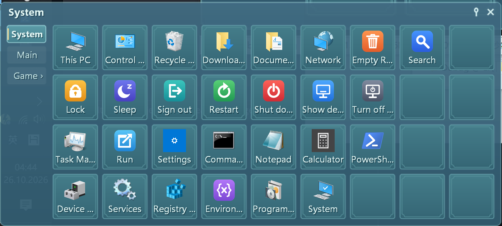
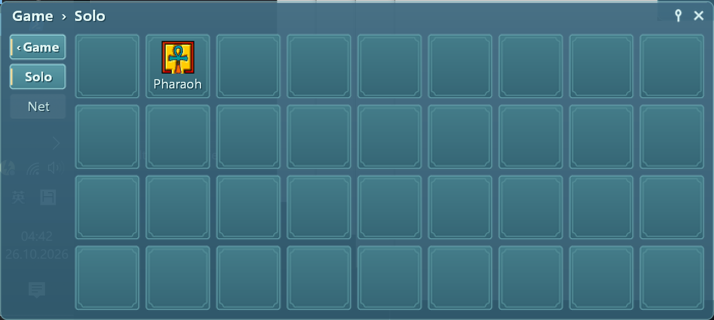
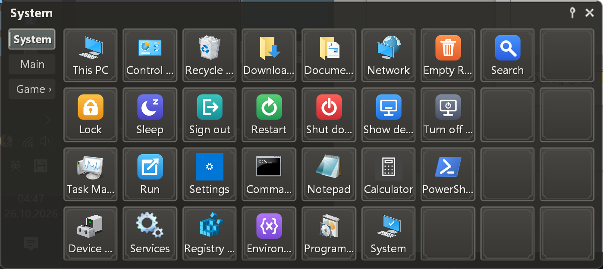
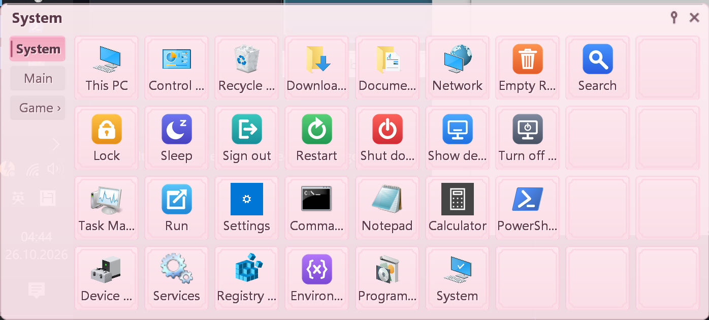
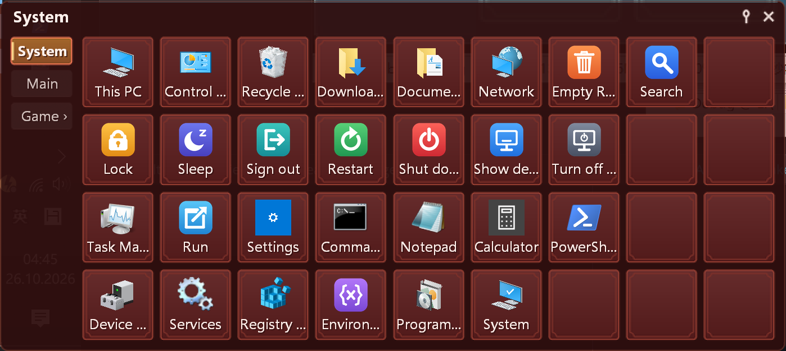
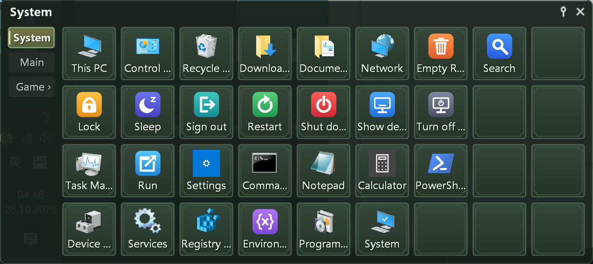
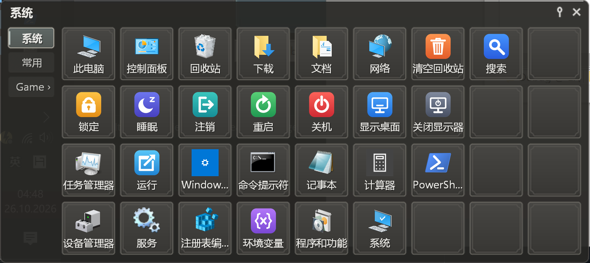

# QLaunch

**English** | [中文](#中文)

A tiny, fast program launcher for Windows with **two levels of tabs**.



## Why QLaunch

- **Tiny.** One exe of under 300 KB. No installer, no .NET, no VC++ runtime: it only uses DLLs that ship with Windows.
- **Instant.** Starts in a blink and pops up the moment the mouse touches a screen corner. Icons are extracted once in the background and cached, so later shows only read the cache.
- **Light on resources.** Pure Win32 with no UI framework. While hidden it frees its icons, images and drawing surface and gives the memory back to Windows, so it uses less than 1 MB of memory sitting in the background.
- **Portable.** Settings and buttons live next to the exe. Copy the folder to a USB stick or another PC and everything comes with it.
- **Two levels of tabs.** Every page can have its own sub-pages, so a hundred programs still stay one or two moves away.
- **Good looking.** A dozen built-in skins, dark and light, with translucent windows and live preview. Make your own in one command with the bundled script.
- **Multi-language.** English and Simplified Chinese included; a translation is one ini file.

## Download

Get the latest zip from [Releases](../../releases), unpack it anywhere and run `QLaunch.exe`. On first run the window shows once and a message tells you how to open it again.

To start it with Windows, tick **Start with Windows** in Settings (no administrator rights needed).

## The interface

### Opening and hiding

QLaunch stays out of sight. Move the mouse into the screen corner you chose (bottom left by default) or press your hotkey, and the window appears at the mouse or at its last position. It hides again when the mouse leaves or you click elsewhere. Click the pin in the top right to keep it open.

### Pages and sub-pages



- **Tabs** run down the left side (or top, right or bottom, as you like). Hover over a tab to switch to it.
- A tab marked **`›`** has sub-pages. Click it and the same tab bar turns into a highlighted **`‹ Game`** tag followed by its sub-tabs. The window never changes size.
- The **caption** shows where you are, such as `Game › Solo`.
- Go back with a click on `‹ Game`, a right-click on the tab bar, `Esc`, or the mouse back button.

### Search

Just start typing while the window is open. Buttons from every page and sub-page whose name (or file name) contains the text take the place of the buttons, and the caption shows how many were found. Chinese names can be found by their pinyin, in full or by initials: `jsb`, `jishiben` and `jishib` all find 记事本, and both readings of a polyphone work. Press `Enter` to start the highlighted one (`Ctrl+Enter` as administrator), move with the arrow keys, and press `Esc` to clear the search. Input methods such as Chinese work too.

### Buttons

- Drag files, folders or shortcuts from Explorer onto the window to add them. This PC, Control Panel, Recycle Bin and other system items work too.
- Websites: drag a link or the address bar from your browser onto the window, or type a web address as the button's target. The button opens it in your default browser and shows the browser's icon.
- Drag buttons to move or swap them, or onto another tab (even a sub-tab) to move them to that page.
- Resize the window by its border and the grid gains or loses rows and columns. Buttons keep their place.
- Right-click a button for Open, Run as administrator, Open file location, Properties and Delete. Right-click a tab to rename it or add a page or sub-page. Right-click the caption for Settings.

### The System page



The first page comes ready to use, in four rows:

1. This PC, Control Panel, Recycle Bin, Downloads, Documents, Network, Empty Recycle Bin, Search
2. Lock, Sleep, Sign out, Restart, Shut down, Show desktop, Turn off display
3. Task Manager, Run, Windows Settings, Command Prompt, Notepad, Calculator, PowerShell
4. Device Manager, Services, Registry Editor, Environment Variables, Programs and Features, System

Sleep, Sign out, Restart and Shut down ask first, with the question box right at the mouse. Switch the language and the page follows it.

### Skins

| | |
|---|---|
|  |  |
|  |  |

Voyage, Sakura, Blaze, Forest, Stone, Glacier, Nebula, Latte and more, plus plain Dark and Light colour schemes. Pick one in Settings and the main window previews it at once. A skin is just a folder or zip of PNG images and a `skin.xml` in the `skins` folder.

#### Make your own skin

The bundled script [`tools/make_skin.py`](tools/make_skin.py) builds a complete skin from five colours. Pick a palette you like on [Realtime Colors](https://www.realtimecolors.com), copy the page link and run (Python 3.8+ with Pillow, `pip install pillow`):

```bat
python tools\make_skin.py MySkin "https://www.realtimecolors.com/?colors=ecf0e8-060705-c1cbb1-464365-a37ca8"
```

The new skin appears in `assets\skins\MySkin`. Copy that folder into the `skins` folder next to `QLaunch.exe` (or zip its contents as `MySkin.zip`) and choose it in Settings. The five colours are text, background, primary, secondary and accent: buttons use the secondary colour, hovering moves towards the primary, and the selected tab and the pin use the accent.

### Settings

Hot corner and delay, hotkey, where the window opens, language, skin, tab position, button and tab sizes, icon size, hover delay, fonts for tabs and buttons, and Start with Windows.

## Tips

- Don't run QLaunch itself as administrator: Windows then blocks drag and drop from Explorer. Use **Run as administrator** on a single button instead.
- Delete `icons.dat` next to the exe (or use **Refresh icons** in the menu) if an icon looks out of date.
- To translate QLaunch, copy `lang/en.ini` to `lang/<code>.ini` (for example `ja.ini`) and translate the text after each `=`.

## Building

Open the folder in VS Code with the CMake Tools extension and Visual Studio 2019/2022 (Desktop development with C++) installed, pick the `x64-release` or `x86-release` preset in the status bar and press `F7`. The exe goes to `out\bin\<preset>`, and a release build also packs it with the language files, skins and icons into `out\release\QLaunch-<version>-x64.zip` (or `-x86.zip`), ready to upload to a GitHub release. The version number is set in `CMakeLists.txt`.

## License

[MIT](LICENSE)

---

<a id="中文"></a>

# QLaunch

[English](#qlaunch) | **中文**

一个小巧、快速的 Windows 程序启动器，支持**二级标签**。


## 为什么选 QLaunch

- **小**：只有一个 exe，不到 300 KB。不用安装，不需要 .NET，也不需要 VC++ 运行库，只用 Windows 自带的 DLL。
- **快**：秒开，鼠标一碰屏幕角落就弹出来。图标只在后台提取一次并缓存，之后打开只读缓存。
- **省**：纯 Win32，不用任何 UI 框架。隐藏时释放图标、图片和画布，把内存还给系统，挂在后台内存占用不到 1 MB。
- **便携**：设置和按钮都存在 exe 旁边，整个文件夹拷到 U 盘或别的电脑上照样用。
- **二级标签**：每个页面都可以有自己的二级页面，上百个程序也只在一两步之内。
- **好看**：自带十几个深色、浅色主题，半透明窗口，设置里即时预览；用附带的脚本，一条命令就能生成自己的主题。
- **多语言**：自带英文和简体中文，翻译只需要一个 ini 文件。

## 下载

在 [Releases](../../releases) 下载最新的 zip，解压到任意位置，运行 `QLaunch.exe`。第一次运行时窗口会显示一次，并弹框告诉你以后怎么打开它。

需要开机自动启动，在设置里勾选“开机自动启动”即可，不需要管理员权限。

## 界面介绍

### 唤出和隐藏

QLaunch 平时不占地方。鼠标移到设定的屏幕角落（默认左下角）或按快捷键，窗口就出现在鼠标处或上次的位置；鼠标离开或点了别处就自动隐藏。点右上角的图钉可以让它一直显示。

### 页面和二级页面


- **标签**默认在左边（也可以放上、右、下），鼠标悬停就切换。
- 带 **`›`** 的标签有二级页面。点它后，同一个标签栏换成高亮的 **`‹ Game`** 返回标签加上它的二级标签，窗口大小始终不变。
- **标题栏**显示当前位置，例如 `Game › Solo`。
- 返回一级标签：点 `‹ Game`、右键标签栏、按 `Esc`，或鼠标侧键“后退”。

### 搜索

窗口打开时直接打字就能搜。所有页面和二级页面里，名称（或文件名）包含这些字的按钮会显示在按钮区，标题栏显示找到几个。中文名称可以用拼音搜，全拼、首字母或混着打都行：`jsb`、`jishiben`、`jishib` 都能找到“记事本”，多音字的每个读音都算。`回车` 启动高亮的那个（`Ctrl+回车` 以管理员身份运行），方向键移动，`Esc` 清空搜索。中文输入法也能用。

### 按钮

- 从资源管理器把文件、文件夹、快捷方式拖进窗口就能添加按钮，此电脑、控制面板、回收站这类系统项目也可以。
- 网站：把浏览器里的链接或地址栏拖进窗口，或者在按钮属性的“目标”里填网址。点按钮用默认浏览器打开，图标显示浏览器的图标。
- 按钮可以拖动换位置，也可以拖到别的标签（包括二级标签）上，移到那个页面。
- 拖动窗口边框调整行列数，按钮留在原位。
- 右键按钮：打开、以管理员身份运行、打开所在位置、属性、删除。右键标签：重命名、新建页面或子页。右键标题栏：设置。

### 系统页



第一页开箱即用，分四行：

1. 此电脑、控制面板、回收站、下载、文档、网络、清空回收站、搜索
2. 锁定、睡眠、注销、重启、关机、显示桌面、关闭显示器
3. 任务管理器、运行、Windows 设置、命令提示符、记事本、计算器、PowerShell
4. 设备管理器、服务、注册表编辑器、环境变量、程序和功能、系统

睡眠、注销、重启、关机会先确认，确认框就在鼠标旁边。切换语言时，这一页也跟着换。

### 主题

| | |
|---|---|
|  |  |
|  |  |

Voyage、Sakura、Blaze、Forest、Stone、Glacier、Nebula、Latte 等，另有朴素的 Dark、Light 配色。在设置里选择，主窗口马上显示效果。主题就是 `skins` 文件夹里的一个文件夹或 zip（PNG 图片加 `skin.xml`）。

#### 自己生成主题

附带的脚本 [`tools/make_skin.py`](tools/make_skin.py) 用五个颜色就能生成一整套主题。在 [Realtime Colors](https://www.realtimecolors.com) 上调出喜欢的配色，复制页面链接，然后运行（需要 Python 3.8+ 和 Pillow，`pip install pillow`）：

```bat
python tools\make_skin.py MySkin "https://www.realtimecolors.com/?colors=ecf0e8-060705-c1cbb1-464365-a37ca8"
```

新主题生成在 `assets\skins\MySkin`。把这个文件夹复制到 `QLaunch.exe` 旁边的 `skins` 文件夹里（或把里面的文件打包成 `MySkin.zip`），在设置里选它即可。五个颜色依次是文字、背景、主色、辅色、强调色：按钮用辅色，悬停时往主色靠，选中的标签和图钉用强调色。

### 设置

热角和延时、快捷键、窗口弹出位置、语言、主题、标签位置、按钮和标签尺寸、图标大小、悬停延时、标签和按钮的字体、开机自动启动。

## 小贴士

- 不要用管理员身份运行 QLaunch 本身，否则 Windows 会拦住从资源管理器的拖放。个别程序需要管理员权限时，在它的按钮上右键选“以管理员身份运行”。
- 图标显示不对时，删掉 exe 旁边的 `icons.dat`（或在菜单里点“刷新图标”）。
- 翻译：把 `lang/en.ini` 复制成 `lang/<语言代码>.ini`（例如 `ja.ini`），翻译每行 `=` 后面的文字即可。

## 编译

装好 Visual Studio 2019/2022（使用 C++ 的桌面开发）和 VS Code 的 CMake Tools 扩展，用 VS Code 打开本目录，在状态栏选 `x64-release` 或 `x86-release` 预设，按 `F7`。exe 输出在 `out\bin\<预设名>`；Release 编译还会把 exe 和语言文件、主题、图标一起打包成 `out\release\QLaunch-<版本号>-x64.zip`（或 `-x86.zip`），可以直接上传到 GitHub Release。版本号在 `CMakeLists.txt` 里设置。

## 许可

[MIT](LICENSE)
